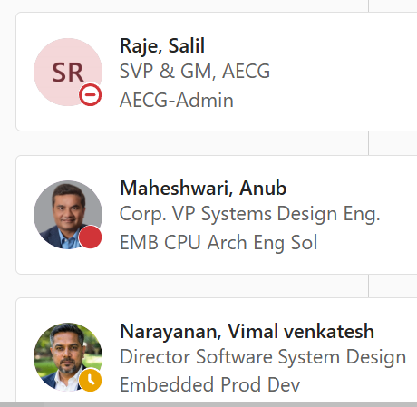
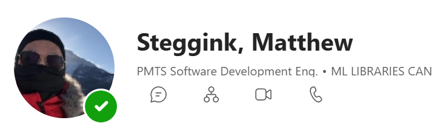
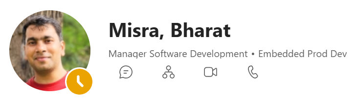
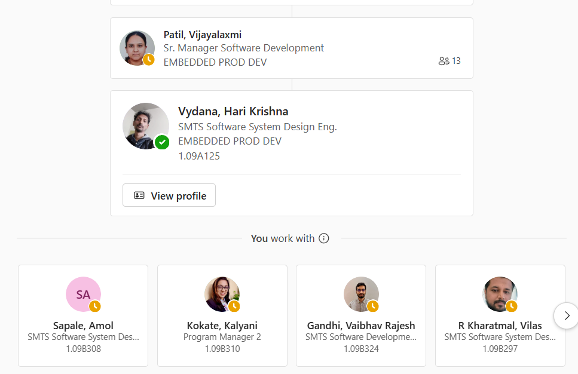

<!-- _class: smallest -->

# Solving the Model Gap — Execution Summary

### AMD-Sourcing the Engineering Cycles to Close NVIDIA's Physical-AI Lead

AMD hardware already wins on economics — roughly 50% lower capex and 30% lower opex than the incumbent, on competitive silicon (MI300X, Ryzen AI, Kria). Yet application developers still say no, because their products are already built around NVIDIA's models and pipelines (NGC, TensorRT, Isaac ROS, cuRobo, Isaac Sim, Cosmos). NVIDIA's moat is roughly 80% ecosystem and 20% hardware: 2M+ robotics developers, a 7+-year head start. Re-hosting a deployment costs 6–18 engineer-months and 5–7 re-targeted artifacts per model — a bill the customer, not AMD, has to pay before hardware economics even enter the conversation. That burden falls hardest on the small and mid-size robotics companies AMD most needs to win. Internally, this gap is known and winnable but cannot be closed by any single business unit: model training is iterative, the payoff is multi-year, and no BU can book near-term ROI on it — so, rationally, nobody starts, and the gap widens.

The way out is to pose this as a *replication problem, not an invention problem*. The target models are named, mostly open, and their performance is already published on NGC — we know exactly what "done" looks like. Only two things are missing: compute, which AMD already has (ALOLA and other AMD-wide clusters), and data, the real work (synthetic generation, pooled and curated open data, semi-supervised labeling, pseudo-labels from large open-source models and data pools). The proposal is an AMD-wide model training challenge: pick a target model, train it on AMD compute, submit a per-model leaderboard, and have PAVS validate and publish the result. This pattern has closed comparable capability gaps before — ImageNet seeded the deep-learning era, the DARPA Grand Challenge seeded self-driving, and Kaggle/Netflix Prize crowdsourced solutions that beat in-house teams at a fraction of the cost. A scored, public target repeatedly does what no single roadmap can.

The mechanism is self-sustaining because every party wins by playing: participating engineers get recognition, a publishable track record, and a countable contribution to AMD; PAVS becomes the customer gateway for physical AI and the bridge across AMD's distributed teams; and AMD closes a strategic ecosystem gap with pooled compute and no single-BU budget line, building a pipeline of market-ready, AMD-native models and datasets along the way. The prize is worth the effort — AMD projects a $200B physical-AI silicon market by 2035, robotics startup funding hit $22.2B in 2025 (+69% YoY). Of 125 NGC models scanned, 48 across four priority tiers need an AMD-native replica (Appendix, Table A1–A4); Tier 1 + Tier 2 (30 models) is the actual "customer has this running on NVIDIA today and can't move it" set.

---

<!-- _class: small -->

# The Ask

### The plan is already staffed — we only need the mandate to start

**What we need from leadership**

An <strong>org-wide email</strong> endorsing the challenge — the signal that gives the effort <strong>good traction</strong>.

The push

**Already staffed &amp; committed — execution is ready**

Compute — grants cluster access (ALOLA &amp; AMD-wide)

Per-model GitHub — creates the per-model repos

Team to drive the work

Known target · staffed team · available compute — all that's missing is the go-ahead.

---

<!-- _class: smallest -->

## Appendix A1 · Tier 1 — Production Perception Stack (NVIDIA Metropolis/DeepStream)

Highest priority — most commonly deployed NGC models a customer runs today and cannot carry over to AMD.

| NVIDIA model | Function | Why it matters |
|---|---|---|
| TrafficCamNet | Vehicle detection (traffic cameras) | Core Metropolis/smart-city SKU |
| PeopleNet / PeopleNet-AMR | Person detection | Most widely deployed DeepStream model |
| License Plate Recognition (LPRNet) + LPDNet | Plate detection + recognition pair | Sold as a pair, tolling/parking/security |
| VehicleMakeNet / VehicleTypeNet | Vehicle attribute classification | Paired with TrafficCamNet in the same pipelines |
| ReIdentificationNet (+ Transformer variant) | Person re-identification across cameras | Retail/security analytics |
| PeopleSemSegNet / PeopleSemSegNet AMR | Person segmentation | Privacy-masking, robotics safety zones |
| Retail Object Detection / Retail Object Recognition | Shelf/product detection | Retail analytics vertical |
| Action Recognition Net | Action/behavior classification | Security, workplace safety |
| BodyPoseNet / PoseClassificationNet | Human pose estimation | Robotics, ergonomics, fitness |
| Optical Character Detection/Recognition (OCDNet/OCRNet) | Scene text OCR | Logistics, document/label reading |

---

<!-- _class: smallest -->

## Appendix A2 · Tier 2 — Robotics/Perception Building Blocks (Physical AI)

The models Isaac ROS perception pipelines are built on — closest to AMD-ROS/AARTS.

| NVIDIA model | Function |
|---|---|
| Bi3D Proximity Segmentation | Stereo-based obstacle proximity |
| ESS DNN Stereo Disparity | Stereo depth |
| FoundationPose | 6-DoF object pose estimation/tracking |
| PointPillarNet | LiDAR 3D object detection |
| Transfusion for 3D Object Detection | Camera+LiDAR fusion detection |
| CitySemSegFormer | Semantic segmentation (autonomy/city-scale) |
| TAO Pretrained Classification/DetectNet V2/EfficientDet/Instance Seg/Semantic Seg | Generic backbones customers fine-tune on top of — AMD needs *some* pretrained backbone family here or customers can't even start a TAO-style workflow on AMD |

Tier 1 + Tier 2 = <strong>30 models</strong> — the real "customer has this running on NVIDIA today and can't move it" set.

---

<!-- _class: smallest -->

## Appendix A3 · Tier 3 — Biometric / Human-Sensing (Smaller but Sticky Niche)

Matters mainly if AMD is also chasing the biometric/kiosk vertical.

| NVIDIA model | Function |
|---|---|
| FaceNet | Face detection |
| FaceDetectIR | Face detection (infrared) |
| GazeNet (Gaze Estimation) | Gaze tracking |
| EmotionNet | Emotion classification |
| GestureNet | Hand/body gesture recognition |
| HeartRateNet | Remote heart-rate estimation |
| Facial Landmark Estimator (FPENet) | Facial landmark detection |
| Pre-trained Deformable DETR NvImageNet Weights | Detection backbone |
| Pre-trained FAN based NVImageNet Classification Weights | Classification backbone |
| Pre-trained GCViT NVImageNet Classification Weights | Classification backbone |
| Visual ChangeNet Classification | Change detection classification |
| NVIDIA Optical Inspection Model | Industrial visual inspection |

---

<!-- _class: smallest -->

## Appendix A4 · Tier 4 — Enterprise Vision & HPC/Climate (Lowest Priority)

Matters mainly if AMD is also chasing the enterprise-vision or HPC-climate vertical.

| NVIDIA model | Function | Why lower priority |
|---|---|---|
| PCB Defect Classification Model | Industrial inspection | NVIDIA AI Enterprise EULA; small footprint |
| PeopleSemSegFormer Model Card | Person segmentation | NVIDIA AI Enterprise EULA; small footprint |
| Pre-trained DINO NvImageNet Weights | Classification backbone | NVIDIA AI Enterprise EULA; small footprint |
| PhysicsNeMo Checkpoints: AFNO_DX_FI-V1-ERA5 | Weather forecasting | NVIDIA Community Model License; HPC/climate-only relevance |
| PhysicsNeMo Checkpoints: AFNO_DX_SR-V1-ERA5 | Weather forecasting | NVIDIA Community Model License; HPC/climate-only relevance |
| PhysicsNeMo Checkpoints: AFNO_DX_TP-V1-ERA5 | Weather forecasting | NVIDIA Community Model License; HPC/climate-only relevance |
| PhysicsNeMo Checkpoints: AFNO_DX_WG-V1-ERA5 | Weather forecasting | NVIDIA Community Model License; HPC/climate-only relevance |
| PhysicsNeMo Checkpoints: DLESyM-V1-ERA5 | Weather forecasting | NVIDIA Community Model License; HPC/climate-only relevance |

48 models across 4 tiers, out of 125 scanned on NGC — the other 77 are either already portable (49) or unresolved catalog entries.

